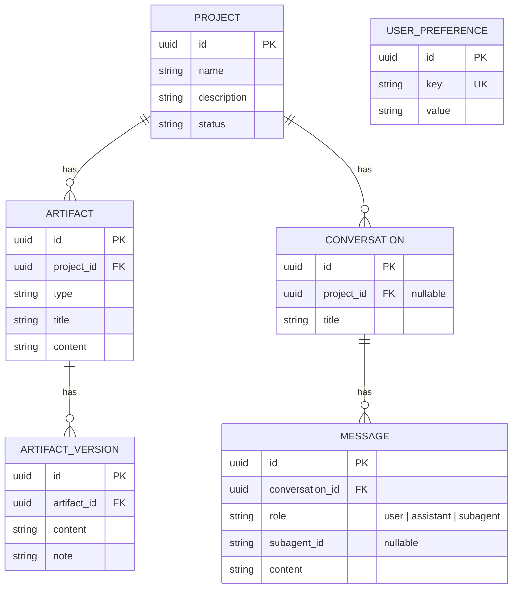

# Data Model

Database: PostgreSQL on Supabase. Schema source of truth: `prisma/schema.prisma`.
All primary keys are `uuid` (`gen_random_uuid()`), all tables use
`created_at`/`updated_at` timestamptz columns.

## Table notes

- **`projects`** — top-level container. A project is the unit everything
  else hangs off: one project has many artifacts and conversations.
- **`artifacts`** — saved outputs: personas, user stories, sitemaps, user
  flows, wireframes. `type` is a free-text discriminator (e.g.
  `"user_flow"`); `content` holds JSON (for diagrams) or Markdown (for
  prose), decided by the caller, not enforced by the schema.
- **`artifact_versions`** — history. Every time an artifact is overwritten,
  the *previous* content is copied into a version row first (see
  `src/app/api/artifacts/route.ts`), so nothing is silently lost on save.
- **`conversations`** / **`messages`** — chat history. `project_id` is
  nullable because a conversation can exist outside any project (e.g. a
  general copilot chat). `messages.subagent_id` is populated only when
  `role = "subagent"` and matches an id in `src/lib/subagents.ts`.
- **`user_preferences`** — a flat key/value table reserved for the future
  Knowledge Brain / personalization layer. Not used by any code yet.

## Not yet modeled

- Anything for the Knowledge Brain / RAG layer (document chunks, embeddings).
  Deliberately deferred — don't add a vector column or pgvector extension
  until there's an actual document to index.
- Figma file/node references for the Design Agent's output.
